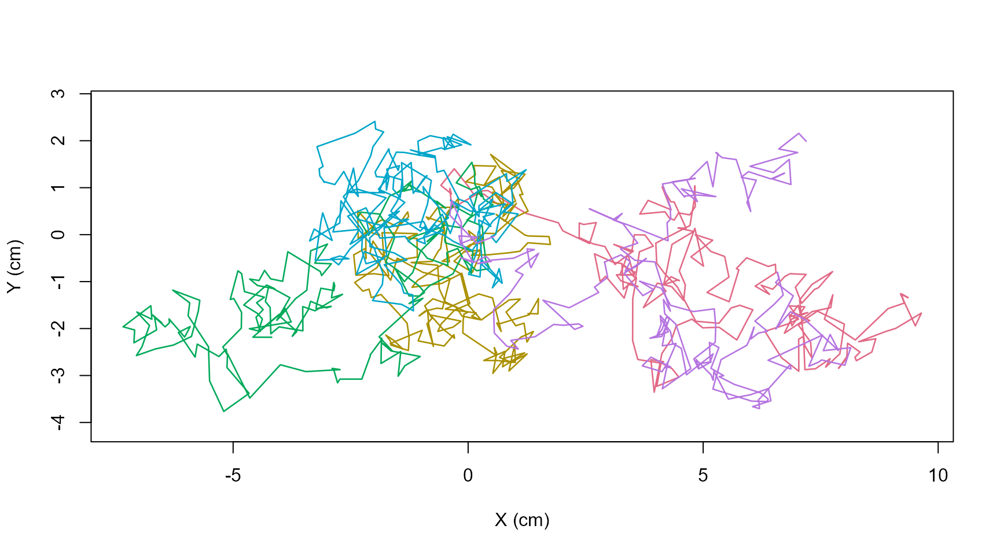

# Get started with AquaTrajectories

## Get started

AquaTrajectories is an open-source research software toolkit for aquatic
movement and multiview trajectories. The public package is named
`aquaTrajectories` (lowercase `a`); the repository is named
`AquaTrajectories`.

**Release:** v0.1.0 — engineering preview. The software’s full-package
tests do **not** establish real fish identity or underwater physical
accuracy.

### Install from GitHub

``` r

install.packages("remotes")
remotes::install_github("stefanosbalaskas/AquaTrajectories", ref = "v0.1.0")
library(aquaTrajectories)
packageVersion("aquaTrajectories")
```

R 4.1 or later is required. Optional modules can require separately
installed `rgl`, `nlme` or `fdapace`. Python video tracking needs
externally supplied fish-trained detector weights and its separately
documented runtime.

### What the whole pipeline looks like


Conceptual software dataflow. No biological data or benchmark
performance is depicted.

### Your first movement analysis

The code below uses the package’s built-in *synthetic random-walk*
simulator. It is suitable for learning the API, **not** estimating
biological fish behaviour.

``` r

library(aquaTrajectories)
set.seed(406)
x <- aqt_simulate_tracks(n_fish = 5, n_frames = 200)
aqt_plot_paths(x)
```



Compute observed kinematics and group summaries:

``` r

kin <- aqt_kinematics(x, max_gap_s = 0.1)
school <- aqt_group_metrics(x, max_gap_s = 0.1)
utils::head(kin)
utils::head(school)
```

The `max_gap_s` threshold prevents a long tracking dropout from being
treated as one continuously observed swimming segment.

### Record and align an event

``` r

event <- aqt_event_table(data.frame(
  session_id = "S01",
  event_id = "routine_event",
  start_s = 3,
  end_s = 4
))
aligned <- aqt_align_events(kin, event)
```

Event labels come from an **external log**. Merely aligning trajectories
to a time interval does not prove that the intervention caused a change.

### Navigating the package

[](https://stefanosbalaskas.github.io/AquaTrajectories/articles/function-atlas.md)

#### All 155 functions

Find each documented function in 14 clearly defined families.

[](https://stefanosbalaskas.github.io/AquaTrajectories/articles/workflows-atlas.md)

#### Research pipelines

Follow the inputs, validation gates and outputs of each workflow.

[](https://stefanosbalaskas.github.io/AquaTrajectories/articles/visualization-gallery.md)

#### Figure gallery

Runnable synthetic plots and publication-style rendering ideas.

### Non-negotiable research assumptions

- Camera-local track numbers are **not** permanent biological animal
  identities.
- Missing 2D depth is **unknown**, not zero.
- A low stereo reprojection residual does not establish correct identity
  or physical metrology.
- Frames and fish nested in one experimental tank do not replace
  independent tank replication.
- HMM state labels and movement features do not independently establish
  stress or welfare.
- Measurement-perturbation intervals are conditional sensitivity
  summaries unless empirically calibrated.

Read the [scientific status and
limitations](https://stefanosbalaskas.github.io/AquaTrajectories/articles/scientific-status.md)
before using outputs in publications.
