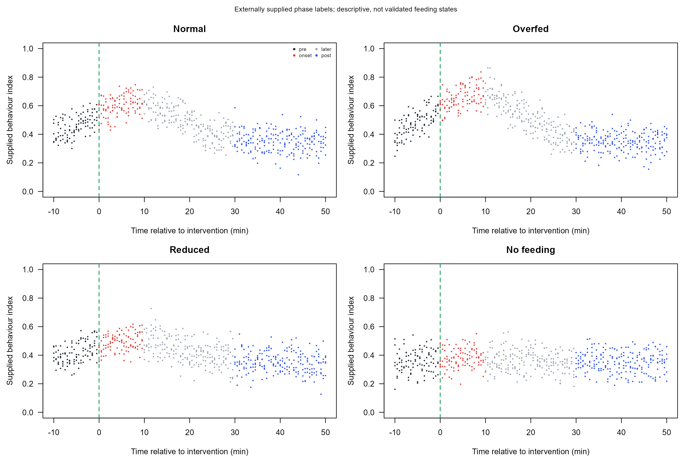
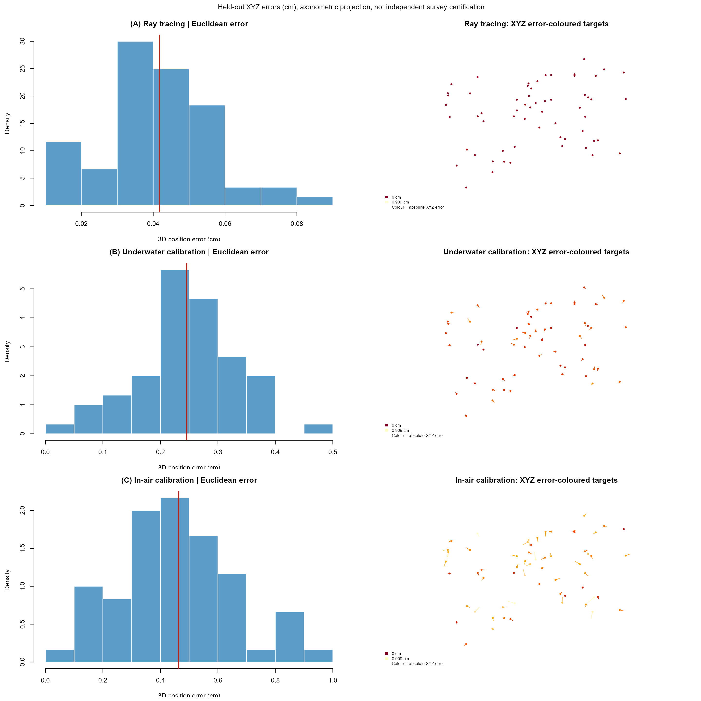
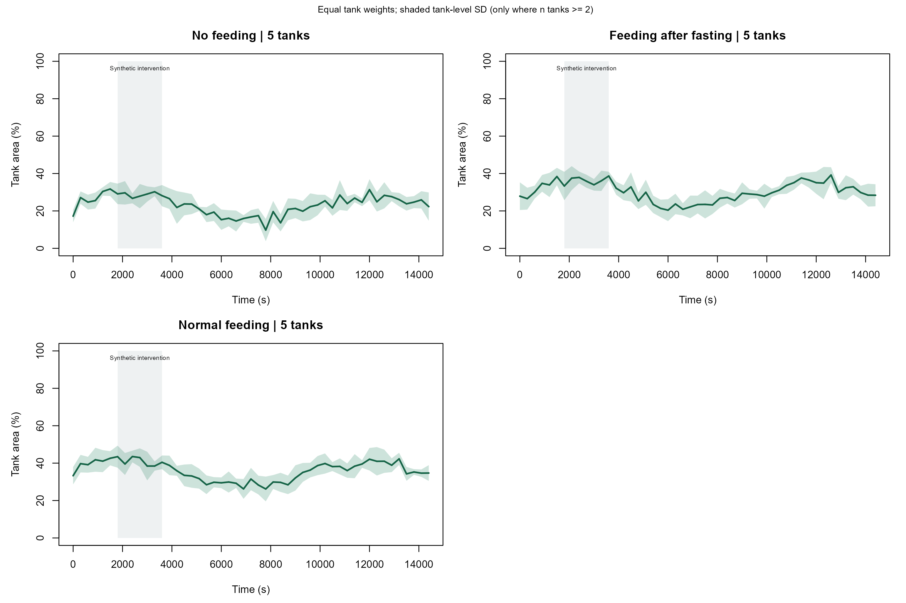
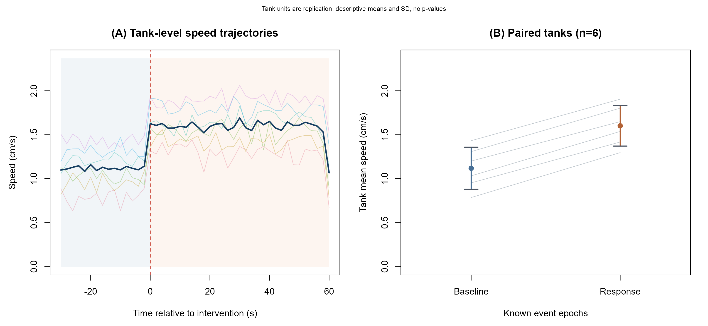
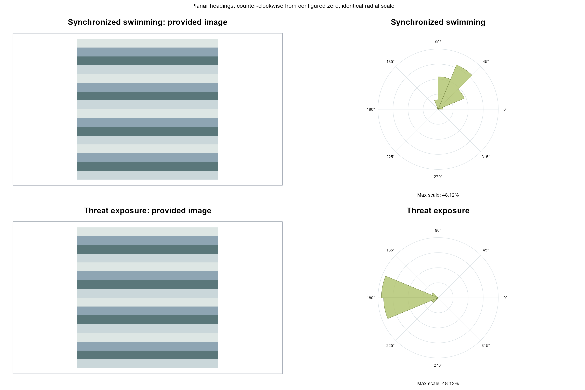

# Five native publication figure families — reproducible synthetic workbook

> **Provenance:** This article reuses the synthetic workbook distributed
> with the tagged package at
> `inst/examples/publication_visualization_gallery.Rmd`, with its
> website-specific metadata updated. No real fish data or verified
> biological effects are represented.

## Scientific scope

All data in this document are deliberately **synthetic**. No feeding
phase was independently annotated, no physical underwater calibration
was performed, no tank was randomized, and no 3D or welfare outcomes can
be inferred from these figures. These are demonstrations of
visualization, input checking, and experimental-unit summaries.

## 1. Feeding index phases (descriptive)

The FBI-like values are invented fractions. The four phase categories
are **supplied explicitly**; AquaTrajectories does not infer or
scientifically validate their feeding interpretation.

``` r

feeding <- expand.grid(
  scenario=c("Normal","Overfed","Reduced","No feeding"),
  time_min=seq(-10,50,by=.5),
  replicate=seq_len(5),
  KEEP.OUT.ATTRS=FALSE, stringsAsFactors=FALSE)
response <- c("Normal"=.28,"Overfed"=.35,
              "Reduced"=.16,"No feeding"=.02)
feeding$fbi <- pmin(1,pmax(0,
  .35 + unname(response[feeding$scenario])*
    exp(-((feeding$time_min-8)/13)^2)+
    rnorm(nrow(feeding),0,.07)))
feeding$phase <- ifelse(feeding$time_min<0,"pre",
  ifelse(feeding$time_min<10,"onset",
    ifelse(feeding$time_min<30,"later","post")))
feeding_plot <- aqt_plot_feeding_states(feeding,event_time_min=0)
```



``` r

print(head(feeding_plot))
```

    ##     scenario phase n_samples
    ## 1     Normal   pre       100
    ## 2    Overfed   pre       100
    ## 3    Reduced   pre       100
    ## 4 No feeding   pre       100
    ## 5     Normal onset       100
    ## 6    Overfed onset       100

## 2. Calibration: 3D position residuals and spatial error map

The points are *synthetic* XYZ targets. Fit and holdout identifiers are
disjoint within each method. The histograms show **nonnegative Euclidean
XYZ position errors**, not signed pairwise-distance errors.

``` r

method_names <- c("Ray tracing","Underwater calibration","In-air calibration")
truth <- data.frame(
  target_id=sprintf("XYZ%03d",seq_len(80)),
  partition=rep(c("fit","holdout"),c(20,60)),
  truth_x=runif(80,0,22),truth_y=runif(80,0,8),
  truth_z=runif(80,0,11))
calibration <- do.call(rbind,lapply(seq_along(method_names),function(i){
  d <- truth
  d$method <- method_names[i]
  d$estimate_x <- d$truth_x+rnorm(nrow(d),0,c(.025,.14,.28)[i])
  d$estimate_y <- d$truth_y+rnorm(nrow(d),0,c(.025,.14,.28)[i])
  d$estimate_z <- d$truth_z+rnorm(nrow(d),0,c(.025,.14,.28)[i])
  d
}))
calibration_summary <- aqt_plot_calibration_comparison(
  calibration,units="cm",require_holdout=TRUE)
```



``` r

print(calibration_summary)
```

    ##                   method n_targets mean_error    rmse_3d  max_error
    ## 1            Ray tracing        60 0.04171218 0.04448452 0.08456348
    ## 2 Underwater calibration        60 0.24563594 0.25949947 0.45305427
    ## 3     In-air calibration        60 0.46352819 0.50045932 0.90925283
    ##   mean_error_x mean_error_y mean_error_z
    ## 1 -0.000259591  0.004550490  0.006715079
    ## 2 -0.029813878  0.001124296 -0.010827080
    ## 3 -0.052140719 -0.031702019 -0.031654155

## 3. Tank occupancy with independent-tank SD bands

The simulated percentage of surface occupied by fish is already supplied
as `area_fraction`. Five tank units per scenario are used. The shaded
areas are descriptive **between-tank SD**, not confidence intervals
inferred from individual frames.

``` r

occupancy <- expand.grid(
  scenario=c("No feeding","Feeding after fasting","Normal feeding"),
  tank_rep=seq_len(5),
  time_s=seq(0,4*3600,by=300),
  KEEP.OUT.ATTRS=FALSE,stringsAsFactors=FALSE)
occupancy$tank_id <- paste(occupancy$scenario,
                           occupancy$tank_rep,sep="_tank")
offset <- c("No feeding"=0,
            "Feeding after fasting"=.07,"Normal feeding"=.12)
occupancy$area_fraction <- pmax(0,pmin(1,
    .22+unname(offset[occupancy$scenario])+
    .07*sin(occupancy$time_s/1500)+rnorm(nrow(occupancy),sd=.05)))
periods <- data.frame(start_s=1800,end_s=3600,
                      label="Synthetic intervention")
occ_summary <- aqt_plot_occupancy_timeseries(
  occupancy,time_bin_s=300,band="sd",periods=periods)
```



``` r

print(head(occ_summary))
```

    ##                scenario time_s mean_fraction   sd_tanks   se_tanks n_tanks
    ## 1 Feeding after fasting      0     0.2789107 0.07396714 0.03307911       5
    ## 2 Feeding after fasting    300     0.2656326 0.05845922 0.02614376       5
    ## 3 Feeding after fasting    600     0.3005086 0.03463592 0.01548965       5
    ## 4 Feeding after fasting    900     0.3475326 0.04476196 0.02001816       5
    ## 5 Feeding after fasting   1200     0.3389380 0.06478149 0.02897116       5
    ## 6 Feeding after fasting   1500     0.3838288 0.04638402 0.02074357       5
    ##   n_frames
    ## 1        5
    ## 2        5
    ## 3        5
    ## 4        5
    ## 5        5
    ## 6        5

## 4. Swimming speed aligned to a documented intervention

Illustrative individual speed samples are aggregated per tank. The right
panel compares paired tank summaries; **no p-values or statistical
significance symbols** are generated.

``` r

speed_data <- expand.grid(
  tank_id=paste0("T",seq_len(6)),
  time_s=seq(-30,90,by=.5),
  KEEP.OUT.ATTRS=FALSE,stringsAsFactors=FALSE)
tank_effect <- setNames(seq(-.3,.3,length.out=6),
                        paste0("T",seq_len(6)))
speed_data$speed <- pmax(0,
  1.1 + unname(tank_effect[speed_data$tank_id])+
  ifelse(speed_data$time_s>=0 & speed_data$time_s<60,.5,0)+
  rnorm(nrow(speed_data),0,.16))
speed_summary <- aqt_plot_speed_response(
  speed_data,event_time_s=0,
  baseline_s=c(-30,0),response_s=c(0,60),
  speed_unit="cm/s",time_bin_s=2)
```



``` r

print(speed_summary$summary)
```

    ##      epoch mean_speed  sd_tanks n_tanks speed_unit
    ## 1 baseline   1.118098 0.2394481       6       cm/s
    ## 2 response   1.600945 0.2303589       6       cm/s

## 5. Circular swimming direction and supplied frame panes

The angle distribution is synthetic and uses **counter-clockwise
mathematical XY conventions**. Actual video pixel coordinates may be
clockwise (y down) and must be transformed explicitly. The optional
raster panes below are synthetic colour patterns, **not fish frames**.

``` r

heading <- data.frame(
  condition=rep(c("Synchronized swimming","Threat exposure"),each=500),
  heading_rad=c(rnorm(500,pi/3,.4),rnorm(500,pi,.25)))
# Optional already-loaded source frames can be passed as named rasters.
# Here they are simulated abstract colours solely to exercise that layout.
fake_frame <- grDevices::as.raster(matrix(
  rep(c("#DDE6E4","#8EA5B3","#5A777A","#CAD7DA"),64),
  nrow=16,ncol=16))
frames <- list("Synchronized swimming"=fake_frame,
               "Threat exposure"=fake_frame)
heading_summary <- aqt_plot_heading_rose(
   heading,bins=16,clockwise=FALSE,scale="fraction",
   frame_rasters=frames)
```



``` r

print(head(heading_summary))
```

    ##               condition bin center_deg n_observations weighted_count proportion
    ## 1 Synchronized swimming   1      11.25             19             19      0.038
    ## 2 Synchronized swimming   2      33.75            113            113      0.226
    ## 3 Synchronized swimming   3      56.25            192            192      0.384
    ## 4 Synchronized swimming   4      78.75            130            130      0.260
    ## 5 Synchronized swimming   5     101.25             38             38      0.076
    ## 6 Synchronized swimming   6     123.75              4              4      0.008
    ##   mean_heading_rad circular_resultant_length
    ## 1         1.009987                 0.9231092
    ## 2         1.009987                 0.9231092
    ## 3         1.009987                 0.9231092
    ## 4         1.009987                 0.9231092
    ## 5         1.009987                 0.9231092
    ## 6         1.009987                 0.9231092

## Publication export

All five functions draw on the active base graphics device. For a vector
PDF, surround a call with
`grDevices::pdf('figure.pdf', width = 12, height = 8)` and
[`grDevices::dev.off()`](https://rdrr.io/r/grDevices/dev.html). For
TIFF, use
`grDevices::tiff('figure.tiff', width = 3200, height = 2200, res = 300)`.
These procedures **only export a visualization**; they do not establish
empirical scientific validity.

## Evaluation

The five new functions can be tested in the source repository using:

``` r

testthat::test_local(
  filter = "publication-visualization-suite",
  reporter = "summary"
)
rcmdcheck::rcmdcheck(args = "--no-manual", error_on = "warning")
```

------------------------------------------------------------------------

For the original, source-controlled training workbook see [the v0.1.0
release
artifact](https://github.com/stefanosbalaskas/AquaTrajectories/blob/v0.1.0/inst/examples/publication_visualization_gallery.Rmd).
