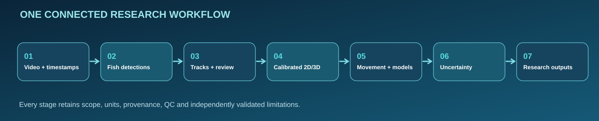

# Fish video tracking and time-faithful data ingestion

## Fish video tracking

AquaTrajectories separates three tasks that are often incorrectly
conflated:

**Fish detection** identifies candidate boxes; **within-video tracking**
assigns provisional camera-local IDs; **biological re-identification**
requires independent evidence that a particular tracked body remains the
same fish, especially across occlusions and views.

### From GoPro recordings to structured observations



The path is conceptual; detector performance requires independent
fish-specific benchmarking.

The optional runner `inst/python/aqt_track_video.py` accepts local
videos with **user-supplied fish-trained YOLO weights**, uses PyAV frame
decoding/PTS metadata, and runs YOLO/ByteTrack with persistent tracker
state. Outputs include frame manifests, MOT boxes, species-class
sidecars and SHA-256 provenance files.

**It does not train a fish detector.** It does not claim universal GoPro
support, automatically label animal welfare, or guarantee stable fish
identities.

### Input contracts

- Capture frame timestamps from the actual recording rather than
  assuming every camera runs at an exact constant FPS.
- Preserve camera, recording, frame and track scopes.
- Keep genuine acquired frames with **no fish detection** in the frame
  manifest.
- Treat detector class, confidence and bounding-box geometry as
  separately auditable data.
- Refuse invalid or ambiguous rows rather than silently extending a
  track across lost observations.

#### Core entry points

[`aqt_frame_manifest()`](https://stefanosbalaskas.github.io/AquaTrajectories/reference/aqt_frame_manifest.md):
validate camera-local frame times, dimensions and frame numbering.

[`aqt_import_mot()`](https://stefanosbalaskas.github.io/AquaTrajectories/reference/aqt_import_mot.md):
import external MOTChallenge/ByteTrack-style 1-based frame and box data
with exact PTS.

[`aqt_import_yolo()`](https://stefanosbalaskas.github.io/AquaTrajectories/reference/aqt_import_yolo.md)
and
[`aqt_import_idtracker()`](https://stefanosbalaskas.github.io/AquaTrajectories/reference/aqt_import_idtracker.md):
import declared external tracking formats.

[`aqt_video_bundle_import()`](https://stefanosbalaskas.github.io/AquaTrajectories/reference/aqt_video_bundle_import.md):
verify a coordinated four-file bundle and metadata consistency.

[`aqt_mot_support_audit()`](https://stefanosbalaskas.github.io/AquaTrajectories/reference/aqt_mot_support_audit.md):
separate acquired but undetected frames from genuinely missing acquired
frames.

### Labeling: what counts as reference truth?

A detector’s own boxes are **not** independent ground truth. Sample and
label frames before inspecting predictions, include verified empty
frames and record reviewer disagreements. For identities, review the
temporal fish assignment across events/occlusions, not merely
frame-level boxes.

The package includes
[`aqt_annotation_frame_plan()`](https://stefanosbalaskas.github.io/AquaTrajectories/reference/aqt_annotation_frame_plan.md),
[`aqt_annotation_plan_audit()`](https://stefanosbalaskas.github.io/AquaTrajectories/reference/aqt_annotation_plan_audit.md),
[`aqt_apply_identity_corrections()`](https://stefanosbalaskas.github.io/AquaTrajectories/reference/aqt_apply_identity_corrections.md)
and
[`aqt_video_bundle_benchmark()`](https://stefanosbalaskas.github.io/AquaTrajectories/reference/aqt_video_bundle_benchmark.md)
for transparent evaluation.

### Example — import then validate

``` r

# Camera PTS and MOT boxes are externally supplied, not guessed.
# Read the exact file schemas before calling these import functions:
?aqt_frame_manifest
?aqt_import_mot
?aqt_video_bundle_import
?aqt_video_bundle_benchmark
```

**Original protocols:** [source
protocol](https://github.com/stefanosbalaskas/AquaTrajectories/blob/v0.1.1/docs/PYAV_YOLO_BYTETRACK_RUNNER.md),
[source
protocol](https://github.com/stefanosbalaskas/AquaTrajectories/blob/v0.1.1/docs/MOT_FRAME_PTS_INGESTION.md),
[source
protocol](https://github.com/stefanosbalaskas/AquaTrajectories/blob/v0.1.1/docs/INDEPENDENT_VIDEO_BENCHMARK.md)
and [source
protocol](https://github.com/stefanosbalaskas/AquaTrajectories/blob/v0.1.1/docs/PREDECLARED_VIDEO_ANNOTATION_SAMPLING.md).

### Practical safeguards

Direct reflections, floating food, surface bubbles, shadows, mixed
species and fish overlap can create false detections or ID swaps.
Quantify those cases separately with annotated challenge strata.
Camera-local IDs are only identifiers assigned by a tracker; do not
describe them as certified biological individual IDs.
