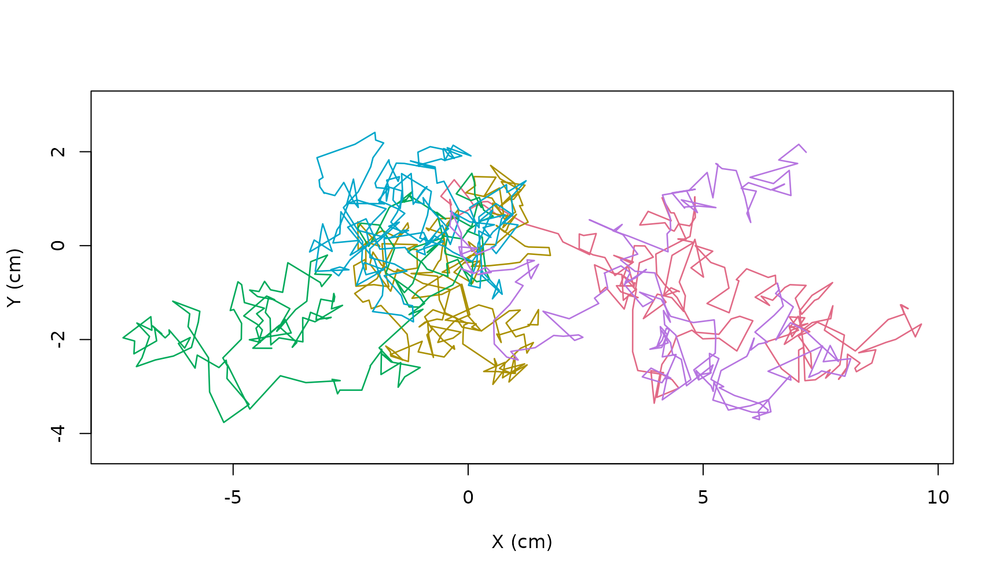
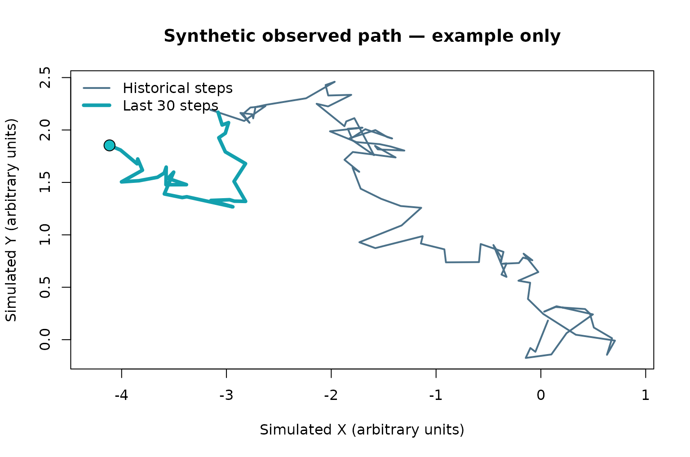
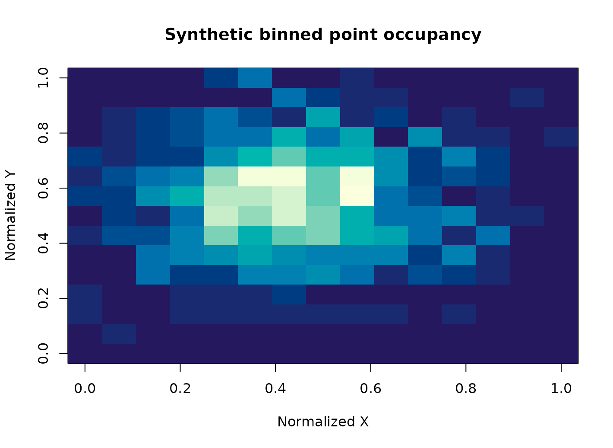
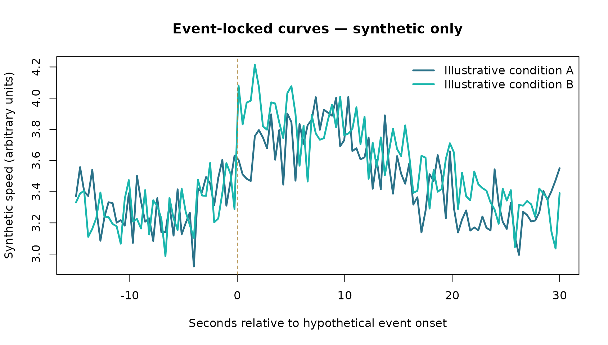

# Scientific visualization gallery

## Visualization gallery

The figures here are **synthetic teaching demonstrations**. They do not
use private fish recordings, claim real detector accuracy or represent
measured animal welfare. The first figure is drawn directly by the
package; subsequent figures illustrate publication-style visual grammar
with transparent base R code.

### Interactive synthetic trajectory explorer

Open the [browser-based synthetic 3D/XY/XZ/YZ
explorer](https://stefanosbalaskas.github.io/AquaTrajectories/synthetic-explorer.md).
It lets you scrub through five fully invented paths, toggle individual
fish and view three orthogonal projections plus a conceptual isometric
projection. It is **not** a real GoPro or empirically calibrated 3D
result.

### 1. Native fish trajectory plot

``` r

library(aquaTrajectories)
set.seed(202611)
toy <- aqt_simulate_tracks(n_fish = 5, n_frames = 200)
aqt_plot_paths(toy)
```



Function:
[`aqt_plot_paths()`](https://stefanosbalaskas.github.io/AquaTrajectories/reference/aqt_plot_paths.md).
No real animal position or tank calibration is implied.

### 2. Clearly synthetic cumulative paths

``` r

set.seed(202612)
n <- 120
x <- cumsum(rnorm(n, sd = 0.16))
y <- cumsum(rnorm(n, sd = 0.11))
plot(x, y, type = "l", lwd = 2, col = "#4B7189",
     xlab = "Simulated X (arbitrary units)",
     ylab = "Simulated Y (arbitrary units)",
     main = "Synthetic observed path — example only", asp = 1)
lines(tail(x, 30), tail(y, 30), col = "#13A0AE", lwd = 4)
points(tail(x, 1), tail(y, 1), pch = 21, bg = "#15BDC4", cex = 1.7)
legend("topleft", legend = c("Historical steps", "Last 30 steps"),
       col = c("#4B7189", "#13A0AE"), lwd = c(2, 4), bty = "n")
```



For calibrated 3D tank positions, see
[`aqt_plot_trajectory_storyboard3d()`](https://stefanosbalaskas.github.io/AquaTrajectories/reference/aqt_plot_trajectory_storyboard3d.md)
instead of treating image pixel coordinates as measured depth.

### 3. Synthetic spatial occupancy concept

``` r

set.seed(202613)
xy <- cbind(rnorm(600, 0.45, 0.18), rnorm(600, 0.56, 0.16))
# Replace matrix contents in place: pmax()/pmin() with a scalar first
# argument can drop the dimensions of its result.
xy[] <- pmin(1, pmax(0, xy))
stopifnot(is.matrix(xy), identical(dim(xy), c(600L, 2L)),
          all(is.finite(xy)), all(xy >= 0 & xy <= 1))
bins <- 15
tab <- matrix(0, bins, bins)
ii <- pmax(1, pmin(bins, floor(xy[, 1] * bins) + 1))
jj <- pmax(1, pmin(bins, floor(xy[, 2] * bins) + 1))
for (k in seq_along(ii)) tab[ii[k], jj[k]] <- tab[ii[k], jj[k]] + 1
image(seq(0, 1, length.out=bins), seq(0, 1, length.out=bins),
      tab, col = hcl.colors(24, "YlGnBu"), xlab="Normalized X",
      ylab="Normalized Y", main="Synthetic binned point occupancy")
```



This is illustrative observed *point density*, not a biologically
validated territory or a physically calibrated tank voxel analysis. See
[`aqt_voxel_occupancy()`](https://stefanosbalaskas.github.io/AquaTrajectories/reference/aqt_voxel_occupancy.md)
for 3D observed XYZ occupancy.

### 4. Synthetic intervention-aligned speed illustration

``` r

set.seed(202614)
t <- seq(-15, 30, length.out = 120)
a <- 3.5 + 0.3*sin(t/5) + rnorm(length(t), sd=.13)
b <- 3.4 + 0.18*sin(t/7) + 0.6*exp(-pmax(t,0)/9)*(t >= 0) +
     rnorm(length(t), sd=.13)
plot(t, a, type="l", lwd=2.5, col="#2B7289", ylim=range(a,b),
     xlab="Seconds relative to hypothetical event onset",
     ylab="Synthetic speed (arbitrary units)",
     main="Event-locked curves — synthetic only")
lines(t,b,col="#1AB6AD",lwd=2.5)
abline(v=0,lty=2,col="#A67D2D")
legend("topright", c("Illustrative condition A","Illustrative condition B"),
       col=c("#2B7289","#1AB6AD"),lwd=2.5,bty="n")
```



Do not infer significance, randomization or a welfare difference from
this diagram. For externally observed, tank-replicated measurements,
consult
[`aqt_plot_speed_response()`](https://stefanosbalaskas.github.io/AquaTrajectories/reference/aqt_plot_speed_response.md)
and
[`aqt_plot_tank_changes()`](https://stefanosbalaskas.github.io/AquaTrajectories/reference/aqt_plot_tank_changes.md).

### 5. Native publication visualizations

The following documented figure families have their **own required input
tables** and are not invoked here with fabricated biological values:

- [`aqt_plot_feeding_states()`](https://stefanosbalaskas.github.io/AquaTrajectories/reference/aqt_plot_feeding_states.md):
  externally defined feeding index and phase labels.
- [`aqt_plot_calibration_comparison()`](https://stefanosbalaskas.github.io/AquaTrajectories/reference/aqt_plot_calibration_comparison.md):
  independent physical target XYZ truth versus estimates.
- [`aqt_plot_occupancy_timeseries()`](https://stefanosbalaskas.github.io/AquaTrajectories/reference/aqt_plot_occupancy_timeseries.md):
  researcher-supplied occupied-area fractions for independent tanks.
- [`aqt_plot_speed_response()`](https://stefanosbalaskas.github.io/AquaTrajectories/reference/aqt_plot_speed_response.md):
  declared speed units, event onsets and tank observations.
- [`aqt_plot_heading_rose()`](https://stefanosbalaskas.github.io/AquaTrajectories/reference/aqt_plot_heading_rose.md):
  observed XY headings with optional supplied video raster frames.

A full synthetic five-figure workbook is already present in the
repository at
[inst/examples/publication_visualization_gallery.Rmd](https://github.com/stefanosbalaskas/AquaTrajectories/blob/v0.1.1/inst/examples/publication_visualization_gallery.Rmd).
Run all five directly in the [website’s five-figure
workbook](https://stefanosbalaskas.github.io/AquaTrajectories/articles/five-figure-workbook.md).
See the [publication figure
guide](https://stefanosbalaskas.github.io/AquaTrajectories/articles/publication-figures.md).
