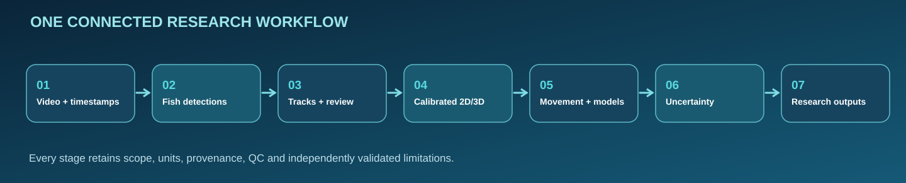

# End-to-end workflow atlas

## Workflow atlas

This atlas connects the existing R package, Python video runner,
JavaScript explorer and scientific protocol documents. Each workflow is
a **research process**, not a guarantee of externally validated
accuracy.

Use the linked function reference for precise arguments and return
values.

### Workflow A — A single-camera experiment

**Inputs:** original video, frame presentation timestamps, known
calibration or scale where applicable, fish-trained detector weights or
independently generated tracks, treatment/event log.

1.  Inspect the source recording and clock metadata.
2.  Decode and track fish with the optional Python runner, or supply
    externally generated MOT/YOLO/idtracker.ai output.
3.  Validate the frame manifest and import the complete video bundle.
4.  Inspect missed detections, ID switches and frame coverage against
    independently annotated frames.
5.  Calculate gap-safe kinematics and event-relative summaries.
6.  Report the number of **independent tanks**, not just fish or frames.

**Functions:**
[`aqt_frame_manifest()`](https://stefanosbalaskas.github.io/AquaTrajectories/reference/aqt_frame_manifest.md),
[`aqt_video_bundle_import()`](https://stefanosbalaskas.github.io/AquaTrajectories/reference/aqt_video_bundle_import.md),
[`aqt_detection_metrics()`](https://stefanosbalaskas.github.io/AquaTrajectories/reference/aqt_detection_metrics.md),
[`aqt_tracking_metrics()`](https://stefanosbalaskas.github.io/AquaTrajectories/reference/aqt_tracking_metrics.md),
[`aqt_kinematics()`](https://stefanosbalaskas.github.io/AquaTrajectories/reference/aqt_kinematics.md),
[`aqt_align_events()`](https://stefanosbalaskas.github.io/AquaTrajectories/reference/aqt_align_events.md).

### Workflow B — Two synchronized cameras to 3D

**Inputs:** two camera PTS timelines, independently estimated
synchronization markers, camera intrinsics/extrinsics, lens and
refraction parameters, image locations and fish correspondence
hypotheses.

1.  Validate synchronized timing from independent holdout markers.
2.  Correct the declared lens distortion.
3.  Declare physical refractive geometry for air–water or
    air–glass–water rays.
4.  Generate provisional cross-view fish candidates; withhold ambiguous
    identities.
5.  Reconstruct only supported paired tracks, preserving source IDs and
    physical diagnostics.
6.  Test physical reconstruction against independent XYZ reference
    targets.

**Functions:**
[`aqt_sync_holdout_fit()`](https://stefanosbalaskas.github.io/AquaTrajectories/reference/aqt_sync_holdout_fit.md),
[`aqt_brown_undistort_tracks()`](https://stefanosbalaskas.github.io/AquaTrajectories/reference/aqt_brown_undistort_tracks.md),
[`aqt_flatport_camera()`](https://stefanosbalaskas.github.io/AquaTrajectories/reference/aqt_flatport_camera.md),
[`aqt_crossview_auto_associate()`](https://stefanosbalaskas.github.io/AquaTrajectories/reference/aqt_crossview_auto_associate.md),
[`aqt_auto_refractive_pipeline()`](https://stefanosbalaskas.github.io/AquaTrajectories/reference/aqt_auto_refractive_pipeline.md),
[`aqt_target_holdout_benchmark()`](https://stefanosbalaskas.github.io/AquaTrajectories/reference/aqt_target_holdout_benchmark.md).

Illustrative only: camera positions and ray lines are not measured
calibration values.

### Workflow C — Detector and tracking validation

**Inputs:** locked predictions plus independent labels for sampled
frames including empty frames.

- Detection: precision, recall, F1, IoU, AP/mAP.
- Identity: IDF1, identity switches and matched positional errors.
- Sampling: documented frame inclusion probabilities and review
  completeness.
- External trackers/official protocols: distinguish these from native
  approximate metrics.

**Functions:**
[`aqt_annotation_frame_plan()`](https://stefanosbalaskas.github.io/AquaTrajectories/reference/aqt_annotation_frame_plan.md),
[`aqt_annotation_plan_audit()`](https://stefanosbalaskas.github.io/AquaTrajectories/reference/aqt_annotation_plan_audit.md),
[`aqt_video_bundle_benchmark()`](https://stefanosbalaskas.github.io/AquaTrajectories/reference/aqt_video_bundle_benchmark.md).

### Workflow D — Tank-replicated event analysis

**Inputs:** logged onset times, treatment assignment by independently
replicated tank, observed fish paths and specified windows.

Conceptual replication design; not an empirical study or prescribed
sample size.

**Functions:**
[`aqt_design_audit()`](https://stefanosbalaskas.github.io/AquaTrajectories/reference/aqt_design_audit.md),
[`aqt_event_epoch_summary()`](https://stefanosbalaskas.github.io/AquaTrajectories/reference/aqt_event_epoch_summary.md),
[`aqt_tank_event_contrast()`](https://stefanosbalaskas.github.io/AquaTrajectories/reference/aqt_tank_event_contrast.md),
[`aqt_functional_tank_contrast()`](https://stefanosbalaskas.github.io/AquaTrajectories/reference/aqt_functional_tank_contrast.md).

### Workflow E — Behavioural and functional trajectories

**Inputs:** observed time series with gap handling and explicit support
across fish/tanks.

**Methods:** change-point summaries, conditional Gaussian HMMs,
DTW/recurrence, sparse FPCA, within-fish longitudinal models.

**Functions:**
[`aqt_state_changepoint()`](https://stefanosbalaskas.github.io/AquaTrajectories/reference/aqt_state_changepoint.md),
[`aqt_hmm_decode()`](https://stefanosbalaskas.github.io/AquaTrajectories/reference/aqt_hmm_decode.md),
[`aqt_trajectory_dtw()`](https://stefanosbalaskas.github.io/AquaTrajectories/reference/aqt_trajectory_dtw.md),
[`aqt_sparse_fpca_fit()`](https://stefanosbalaskas.github.io/AquaTrajectories/reference/aqt_sparse_fpca_fit.md),
[`aqt_functional_longitudinal_fit()`](https://stefanosbalaskas.github.io/AquaTrajectories/reference/aqt_functional_longitudinal_fit.md).

### Workflow F — Uncertainty sensitivity

**Inputs:** externally assumed or independently estimated image,
geometric, ID-switch and model errors.

**Approach:** keep the observational record immutable, generate
specified perturbation scenarios, rerun downstream quantities and report
conditional sensitivity separately from tank-sampling uncertainty.

**Functions:**
[`aqt_trajectory_ensemble()`](https://stefanosbalaskas.github.io/AquaTrajectories/reference/aqt_trajectory_ensemble.md),
[`aqt_identity_switch_scenarios()`](https://stefanosbalaskas.github.io/AquaTrajectories/reference/aqt_identity_switch_scenarios.md),
[`aqt_joint_refractive_scenarios()`](https://stefanosbalaskas.github.io/AquaTrajectories/reference/aqt_joint_refractive_scenarios.md),
[`aqt_joint_tank_sensitivity()`](https://stefanosbalaskas.github.io/AquaTrajectories/reference/aqt_joint_tank_sensitivity.md).

### Workflow G — Publish research figures

Export figure devices from base R, verify units and labels, and retain a
provenance statement. See [publication
figures](https://stefanosbalaskas.github.io/AquaTrajectories/articles/publication-figures.md)
and the [figure
gallery](https://stefanosbalaskas.github.io/AquaTrajectories/articles/visualization-gallery.md).

### Workflow H — Animal–Computer Interaction

Audit externally recorded action, detector, command and response
timestamps and distinguish simulated logic from ethically reviewed
physical hardware operation. See [ACI
workflows](https://stefanosbalaskas.github.io/AquaTrajectories/articles/aci-workflows.md).

### Which workflow should I start with?

| Your dataset | Initial workflow | Next checkpoint |
|----|----|----|
| One GoPro, no annotations | A + C | Independently annotated evaluation frames |
| Two cameras, known calibration | B | Clock and physical XYZ holdouts |
| Tracking CSV only | A (from import) | Missing-frame and ID QC |
| Five fish, several tanks, event log | D | Confirm independent experimental tank count |
| Time-dependent state measurements | E | Observational gaps, state assumptions and tanks |
| Multiple uncertain fish identities | F | Sensitivity distributions, not certified intervals |
| ACI choice/actuator logs | H | Operator authorization, safety, external behavioural review |

The [source
protocols](https://github.com/stefanosbalaskas/AquaTrajectories/tree/v0.1.0/docs)
provide further constraints and data schemas.
