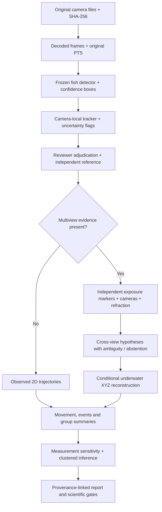

# AquaTrajectories: A provenance-aware computational framework for aquatic-animal trajectories, multiview reconstruction, and uncertainty-sensitive inference

**Manuscript type:** full research-software / computational-methods paper (journal-agnostic draft)  
**Dossier version:** methods-v0.1.0, 2026-11-16  
**Software baseline:** AquaTrajectories v0.1.1 (GitHub commit 43101800087a18d0942da4d03e21ea47099cb7a9; Zenodo DOI 10.5281/zenodo.24262905)  
**Scientific status:** engineering architecture demonstrable; *independent end-to-end empirical validation is pending*. Results and performance conclusions MUST NOT be fabricated.  
**Provisional author:** Stefanos Balaskas (University of Patras; ORCID 0000-0003-2444-9796), **verify authorship and contributions before submission**. Do not add coauthors without their agreement.

## Abstract — PROVISIONAL; validation results withheld

Quantifying aquatic-animal behaviour from video requires a chain of decisions spanning frame acquisition, object detection, within- and across-view association, geometry, time alignment, trajectory analysis, and inference. Errors introduced early in this chain can alter later interpretations, yet software workflows frequently emphasize successful visualization or aggregate tracking scores without preserving the evidence needed to distinguish detection, identity, timing, reconstruction, and scientific validity. We describe **AquaTrajectories**, an open-source R research package with optional Python video-processing components and browser-based research interfaces, designed to preserve traceability between original observations, reconstructed movement and downstream analyses. Its modules represent camera- and session-scoped observations, source presentation timestamps, conditional cross-view identities, refraction-aware stereo reconstruction, event alignment, kinematic and group-level summaries, and measurement-error sensitivity. We specify an independent multistage validation protocol involving frozen fish detectors, alternative trackers, officially defined tracking metrics, measured camera-exposure synchronization, independently surveyed underwater targets, and recording-/tank-level statistical units. Current source qualification demonstrates functioning software contracts and selected real-source integrations but **does not establish generalizable fish identity accuracy, independently measured 3D error, empirical interval coverage, causal behavioural effects or device safety**. The accompanying versioned reproducibility dossier supplies frozen evidence requirements, reporting shells and fail-closed provenance checks, enabling prospective empirical evaluation without mistaking synthetic software tests for biological accuracy.

**Keywords:** aquatic animal tracking; fish behaviour; multiview geometry; refraction; multi-object tracking; scientific reproducibility; measurement error; R research software.

## 1. Introduction

Video-based observations provide a flexible record of aquatic-animal locomotion, spatial occupancy, interactions, and responses to experimental events. However, a video-to-inference claim traverses several separable inferential layers: a fish must first be detected correctly, matched over time, matched across cameras where applicable, located in a coordinate system, linked to the proper event clock, and then analyzed with experimental units and measurement uncertainty respected. A tracked point or visually plausible three-dimensional path alone cannot identify a fish reliably, prove physical positional accuracy, or demonstrate a treatment effect.

Existing work has provided influential domain-specific baselines. Dutta and colleagues' Detect+Track targets fish detection and tracking under obstacles and occlusion [Dutta2025]. The 3D-ZeF resource supplies stereo zebrafish video and annotated benchmark identities for multi-object tracking [Pedersen2020]. The ByteTrack algorithm demonstrates an association strategy that incorporates low-scoring detections [Zhang2022], while HOTA separates tracking detection and association components [Luiten2021]. Such tools and datasets address important elements of the computational pipeline. The research problem motivating AquaTrajectories is **integration with explicit evidence boundaries**: how to connect observations, identity hypotheses, time, underwater geometry, scenario uncertainty and downstream animal-behaviour analyses without silently converting intermediate software outputs into validated biological or physical measurements.

The objectives are (i) to present the modular architecture and its fail-closed data contracts; (ii) to define reproducible, separated evaluations of detection, tracking, multiview timing, absolute XYZ reconstruction and uncertainty calibration; (iii) to demonstrate how experimental event analysis depends on identity, timestamps and independent tank-level replication; and (iv) to deliver an auditable, versioned protocol that can be executed when independent data become available. This paper **does not claim** a new detector architecture, a novel general-purpose 3D-ZeF benchmark, or a newly established animal-welfare diagnostic.

## 2. System architecture and implementation

### 2.1. Package and computational boundary

AquaTrajectories v0.1.1 is released under MIT licensing as an R package containing 155 exported R functions, documentation and tests, with optional Python video-runner and offline JavaScript explorer modules. The public package provides interfaces for two-dimensional tracks, conditional multiview three-dimensional reconstruction, kinematics, schooling and spatial summaries, event alignment, change-point and statistical/functional representations, uncertainty scenarios and diagnostics. Python modules interface with video decoders, fish-trained detector weights and association algorithms **only when separately configured**. No universal detector weights or validation videos are distributed by the R package. Hardware ACI extensions have software safety contracts; device-level safety and animal-welfare validity are not independently certified.

### 2.2. Data provenance and canonical observation representation

The canonical observation records a session ID, camera ID, camera-scoped track label, observation time, spatial coordinates, units, coordinate system and an explicit observed/missing state. Fish labels are not promoted to permanent individual identity simply because tracker software assigned an integer. The Python-to-R bundle retains fully enumerated decoded frames, source video presentation times, local detection/track observations, class sidecars, and a hash-linked manifest. Empty frames are retained for benchmark denominators. Input hashes provide integrity verification; unsigned hashes do not prove provenance authenticity or that annotators were independent.

The minimal source lineage is:

The figure shows intended data flow, not a claim that all empirical gates have passed.

### 2.3. Fish detection and camera-local association

Source-frame detections are recorded as axis-aligned image rectangles, class labels, confidence scores, and the complete evaluated-frame manifest. A detector may be an external trained model; its weights, training sources, resizing, class mapping, threshold and nonmaximum suppression settings must be frozen. Track associations are local to a camera and recording. Identity errors, fragmented tracks and absent detections are preserved. Reference boxes and ID labels must be obtained independently of the evaluated predictions if claims of external accuracy are intended. Comparisons against source-final labels influenced by a source model are described as **source-reference agreement**, not prediction-blind evaluation.

### 2.4. Time alignment and multiview correspondence

The package distinguishes decoded presentation timestamps from actual exposure simultaneity. Shared physical timing markers can support affine clock mapping, expressed as `t_ref = a + b * t_camera`, with separate fit and heldout markers and explicit drift residuals. A matching file time or nominal frame rate does not prove simultaneous exposures. Conditional fish correspondences are constrained by session, geometric consistency, time tolerance and ambiguity; unmatched fish remain unmatched rather than being assigned a forced across-camera identity.

### 2.5. Refraction-aware geometry and physical validation

Where physical camera parameters are supplied, rays are reconstructed in a declared coordinate system with lens calibration, camera pose and, when required, the optical interface between air, glass and water. The triangulated location depends on assumed/estimated calibration and fish correspondences. Consequently, reprojection residuals and ray separation quantify **internal geometric consistency**, not external physical accuracy. Independent surveyed underwater landmark XYZ coordinates, sampled over depth and field position and disjoint from calibration targets, are necessary for a reported absolute XYZ root-mean-square error. Failures to reconstruct are included in denominators. Uncalibrated one-camera inputs remain 2D.

### 2.6. Movement, events and measurement uncertainty

With units and timestamps specified, downstream outputs can represent displacement, speed, turning, spatial occupancy, schooling, event-relative trajectories and temporal behavioural models. A tracking gap is not assumed observed or automatically bridged. Scenario perturbations may represent missing detections, pixel noise, camera synchronization, identity ambiguity, and optical calibration sensitivity. Such sensitivity draws are **conditional scenarios**, not calibrated posteriors or frequentist confidence coverage until fitted and evaluated with independently observed residuals.

Biological interpretations are a separate inferential step. Numerical clusters or HMM state labels are not directly equivalent to stress, welfare, preference or agency. If interventions occur at a tank level, the randomized tank—not hundreds of fish frames—sets the independent experimental unit. Experimental estimates should preserve repeated fish and trial dependence and should not interpret descriptive pre/post changes as automatically causal.

### 2.7. Offline researcher visualization and audit trail

The offline research interface can display original local video, timestamped trajectories, events and reviewer notes. The public teaching explorer and the website's plot gallery are **synthetic demonstrations**. Reviewer notes are draft annotations, not externally verified identity truth. A published figure should link to its input manifest, exact source/video/model hashes, analytical configuration, environment and figure-generation command; no user-input video or nonredistributable source labels are silently shipped.

## 3. Prespecified independent validation

A prospective protocol accompanies this article; do not replace it with a retrospective narrative after reviewing outcomes. All experiment-specific criteria must be registered or timestamped before heldout inspection. The five validation layers are detailed in [REGISTERABLE_PROTOCOL.md](REGISTERABLE_PROTOCOL.md) and [STATISTICAL_ANALYSIS_PLAN.md](STATISTICAL_ANALYSIS_PLAN.md).

### 3.1. Level I — Source video and detector outputs

Select whole recordings and tanks for holdout, recording source rights, exact bytes, annotator independence and every evaluated frame including empty frames. Freeze all model weights and thresholds before scoring. Report TP, FP, FN, precision, recall, F1 and AP by dataset/domain/species, confidence and localization criteria, with errors stratified by crowding, reflections, shadows and reviewer-verified occlusion. Cross-domain transfer claims require genuinely unseen recordings and a documented training/test overlap audit.

### 3.2. Level II — Fish identity and association

Compare ByteTrack and a distinct fixed-association baseline on exactly the same predicted boxes and timestamps. Score against independently reviewed fish identities using a pinned official TrackEval implementation of HOTA, DetA, AssA, IDF1 and CLEAR outcomes. Separate detection-oracle association from model-detection pipelines; oracle scores must never masquerade as end-to-end detection performance. Report track fragmentation, ID switches, unmatched observations and explicit untracked fish.

### 3.3. Level III — Physical time and underwater XYZ

In real multiview trials, acquire external shared timing evidence and separate fit/holdout pulses. On independently surveyed underwater targets disjoint from fitted camera calibration, report axis-wise bias, axis-wise RMSE, Euclidean XYZ RMSE/MAE, depth/location-specific errors and invalid reconstruction rates. A source-provided 3D fish annotation is suitable for *agreement with that annotation*, not necessarily absolute metrological truth. Repeat in distinct tank/camera configurations to assess domain shift.

### 3.4. Level IV — Joint uncertainty coverage and propagation

Estimate component errors using separate calibration data: detector misses/false positives, label switches, pixel localization, timing and optical parameter uncertainty. Propagate dependency-aware error draws through derived kinematics and experimental contrasts. Evaluate interval coverage and width against independent heldout physical targets and reviewer-labeled trajectories; explicitly report out-of-domain calibration failure. Report sensitivity and uncertainty separately if validation data are insufficient.

### 3.5. Level V — Behaviour, independent tanks and optional ACI

For a real animal experiment, preregister biologically motivated outcomes and their independent reference labels, ethical permission, tank randomization, allocation, exposure windows and hierarchical model. Estimate treatment effects with repeated measures and tank-level inference. ACI device trials require actual interlocks, emergency stop, command/response logging and ethics approval. This validation layer is **not satisfied** by hardware simulation, invented feeding traces or one tank recorded repeatedly.

## 4. Existing evidence and withheld empirical results

### 4.1. Current software / real-source feasibility

The official v0.1.1 release and repository workflows provide source-code tests and integration exercises. The earlier Oxford sequence study documented a frozen fish-specific EfficientDet-D2 model executed on 149 original video frames, followed by ByteTrack and scoring against original reviewed annotations. At one recorded threshold/IoU combination, the repository documentation records F1 approximately 0.696 against source-final boxes, not an independently blinded heldout estimate [`docs/OXFORD_FROZEN_SEQUENCE_BENCHMARK.md`]. Fraunhofer source-domain work uses 101 original ricefish frames with model-generated detections and original persistent-ID labels; the original annotation process was at least partly semi-automated and must not be assumed prediction-blind [`docs/FRAUNHOFER_EXTERNAL_FISH_MODEL_METRICS.md`]. These engineering precedents explain feasibility. **They are not the preregistered external validation study proposed here.**

### 4.2. Independent results — NOT YET AVAILABLE

**[BLOCKED: do not substitute examples for real results.]** Tables for heldout detection, tracking, physical synchronization, 3D error and empirical coverage remain intentionally blank in [REPORTING_BLUEPRINT.md](REPORTING_BLUEPRINT.md). Once original data, reviewed labels, independent tank/target splits and ethics where applicable are obtained, populate them with source-identifiable numbers and validated confidence intervals. Until then, no claim of improved tracking, reduced physical XYZ error, improved biological inference or causal welfare benefit is justified.

## 5. Discussion and implications (conditional, not result-based)

The contribution of the framework is methodological **traceability and integration**. Explicit sources, frame denominators, recording-scoped labels, cautious multiview handling and conditional uncertainty can make it easier to identify which step of an analytical chain produced a conclusion. Its scientifically testable advantage is whether, given equally frozen detection models and data, the integrated contracts reduce unrecognized data lineage mistakes, expose cross-view uncertainty and preserve defensible downstream inference relative to alternative pipelines. Those comparative outcomes remain unmeasured under independent holdout conditions.

Limitations are material: the R package does not distribute a universally validated fish detector; complex scenes can produce ambiguous identity hypotheses; physical multiview accuracy depends on true timing, optical configuration and surveyed targets; uncertainty calibration under realistic nonrandom detection loss has not been certified; and movements are not validated welfare constructs without dedicated reference biology. External data licenses can restrict redistribution and annotation formats may require manual verification. Publication-ready claims therefore need a level-specific presentation rather than a blanket assertion that the system is "validated."

## 6. Software, data, ethics and transparency

**Software availability:** Balaskas, S. (2026). *AquaTrajectories*, v0.1.1, Zenodo, DOI [10.5281/zenodo.24262905](https://doi.org/10.5281/zenodo.24262905); source tag [v0.1.1](https://github.com/stefanosbalaskas/AquaTrajectories/releases/tag/v0.1.1), MIT license. Empirical analysis software and exact frozen model/tool manifests must be archived with the study when run.

**Data availability:** The present dossier includes no independently measured original fish videos, blinded identity ground truth, hardware timing logs, surveyed XYZ calibration targets, or ethical animal experimental outcomes. Public Oxford/Fraunhofer/3D-ZeF sources are identified by original-host URLs and reference documents; licenses must be checked for each downloaded asset, and restricted original media are **not redistributed** in the software archive. Future derived outputs should carry individual source hashes and permitted access details.

**Ethics:** No live-animal intervention or physical device trial was performed as part of preparing this manuscript/protocol dossier. A later animal experiment must use locally required institutional approvals and ARRIVE 2.0 reporting, with exact approval IDs supplied only when real approvals exist.

**Preregistration:** This validation protocol has **not been preregistered** by depositing this Markdown document. Record the actual registration URL/date in the study manifest before heldout analysis.

**Funding and interests:** [TO BE CONFIRMED BY AUTHOR; no grants or conflicts invented].

**AI assistance:** [REQUIRES AUTHOR VERIFICATION] A generative AI assistant contributed to drafting and packaging this publication protocol. The author(s) must review all citations, software claims, methods, analyses and provenance, disclose assistance according to the target journal's policy, and retain full responsibility for the work.

**Author contributions:** [TO BE CONFIRMED BY AUTHOR — use CRediT roles and verify actual substantive contributions].

## References

Full bibliographic metadata are maintained in [LITERATURE.bib](LITERATURE.bib). Core sources: Dutta et al. (2025) DOI 10.1098/rsos.242086; Pedersen et al. (2020) 3D-ZeF CVPR; Luiten et al. (2021) DOI 10.1007/s11263-020-01375-2; Zhang et al. (2022) DOI 10.1007/978-3-031-20047-2_1; Percie du Sert et al. (2020) DOI 10.1371/journal.pbio.3000411; AquaTrajectories software DOI 10.5281/zenodo.24262905.
